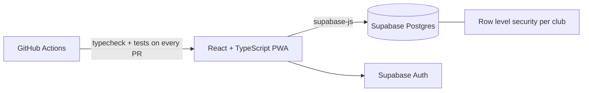

# ARM15

A mobile-first club management platform for grassroots and amateur rugby. It replaces the WhatsApp threads and spreadsheets that most clubs run on with one place for availability, selection, training and match data.

> **About this repository:** the application source is private. This repo is a public overview of the product and how it is built.

## The problem

Amateur clubs pick teams from group chats. Availability arrives as scattered replies, selectors rebuild the same spreadsheet every week, and coaching knowledge lives in individual heads. ARM15 puts the whole weekly loop in one app: who is available, who plays where, what training looks like, and how the season is going.

## What it does

- **Availability grid:** players respond once, coaches see the whole squad at a glance
- **Selection board:** drag-and-drop team selection with a depth chart per position
- **Match results and stats:** results, events and per-player match notes
- **Attendance and sessions:** training sessions, attendance tracking and calendar views
- **Drill library and play designer:** a searchable drill library, a pitch editor, animated play presentation and shareable decks
- **Player hub:** a lightweight player-facing app for fixtures, availability and selection status
- **Director of Rugby dashboard:** a cross-team readiness view for clubs running several sides
- **PDF output:** printable team sheets and drill sheets
- **Installable PWA:** works from the home screen on a phone

## How it is built

| Area | Choice |
|---|---|
| Front end | React, TypeScript, Vite, Tailwind CSS, installable PWA |
| Data | Supabase (Postgres, Auth), multi-tenant by club |
| Access control | Row level security policies across the schema |
| Interaction | dnd-kit for drag-and-drop selection and ordering |
| Documents | react-pdf for team sheets and drill sheets |
| Quality | Vitest and Testing Library, TypeScript checks and tests on every pull request |
| Schema | 80+ versioned SQL migrations |

More detail in [docs/architecture.md](docs/architecture.md).

## Status

In active development.

---

All rights reserved. This repository contains documentation only.
